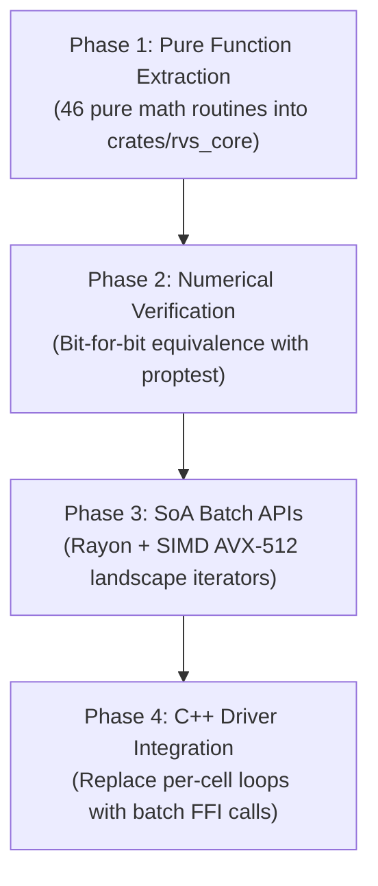

# Unified RVS Rust Candidate Catalog: Biomass, Fuels, Succession, and Disturbance Modules

## Executive Summary & Ecological Architecture Overview

The Rangeland Vegetation Simulator (RVS) is a multi-scale spatial ecology platform simulating vegetation succession, biomass production, fuel loading, and disturbance responses across hundreds of thousands of grid cells over multi-decade time horizons. Under legacy C++11 implementations, core mathematical models were tightly coupled with SQLite database state, heap allocations, and Object-Oriented pointer hierarchies, inducing memory fragmentation, cache misses, and runtime overhead.

During this modernization initiative, all four simulation modules (`Biomass`, `Fuels`, `Succession`, and `Disturbance`) were refactored to C++20:
- Manual memory allocations (`new`/`delete`, raw pointer arrays) were replaced with RAII, `std::array`, and stack/value semantics.
- Variables, parameters, and query member functions were made `const` by default.
- Boost dependencies (`<boost/any.hpp>`) were eliminated in favor of standard library `<any>` and `std::span`.
- Isolated mathematical subroutines were extracted into pure `constexpr` / `noexcept` functions with zero side effects.

Because these routines are **100% pure computational kernels** operating on scalar inputs and outputs, they are ideal candidates for migration to a high-performance Rust crate (e.g. `librvs_core` or `rvs_sim_core`). This document provides the complete, unified catalog of **46 mathematical subroutines**, their rigorous LaTeX specifications, idiomatic Rust implementations, C FFI bindings, Structure-of-Arrays (SoA) batch layouts, and integration roadmap.

---

## 1. Candidate Catalog Overview

| ID | Subroutine | Module / File | Ecological Purpose | Purity & Safety | Vectorization Potential |
|---|---|---|---|---|---|
| **B01** | `eq_165` | `Biomass::BiomassEquations` | Linear cover-based biomass | Pure `constexpr` / `noexcept` | Trivial SIMD FMA |
| **B02** | `eq_201` | `Biomass::BiomassEquations` | Exponential cover-based biomass | Pure `noexcept` | Vectorized `exp` |
| **B03** | `eq_202` | `Biomass::BiomassEquations` | Power-law cover-based biomass | Pure `noexcept` | Vectorized `log` / `exp` |
| **B04** | `eq_636` | `Biomass::BiomassEquations` | 3D dimensional volume log-linear | Pure `noexcept` | SIMD 3-channel multiply |
| **B05** | `eq_636_2` | `Biomass::BiomassEquations` | Direct volume log-linear | Pure `noexcept` | Vectorized `log` / `exp` |
| **B06** | `eq_743` | `Biomass::BiomassEquations` | Canopy cover-height interaction | Pure `constexpr` / `noexcept` | Trivial SIMD FMA |
| **B07** | `eq_998` | `Biomass::BiomassEquations` | Shrub width $\log_{10}$ power law | Pure `noexcept` | Vectorized $\log_{10}$ / `pow` |
| **B08** | `eq_999` | `Biomass::BiomassEquations` | Bivariate length-width $\log_{10}$ | Pure `noexcept` | Vectorized $\log_{10}$ |
| **B09** | `eq_1000` | `Biomass::BiomassEquations` | Trivariate dimensions $\log_{10}$ | Pure `noexcept` | Vectorized $\log_{10}$ |
| **B10** | `eq_1002` | `Biomass::BiomassEquations` | Linear scaled volume | Pure `constexpr` / `noexcept` | Trivial SIMD FMA |
| **B11** | `eq_1008` | `Biomass::BiomassEquations` | Trivariate natural log exponential | Pure `noexcept` | Vectorized $\ln$ / `exp` |
| **B12** | `eq_1012` | `Biomass::BiomassEquations` | Bivariate natural log exponential | Pure `noexcept` | Vectorized $\ln$ / `exp` |
| **B13** | `eq_1058` | `Biomass::BiomassEquations` | Polynomial + square-root model | Pure `noexcept` | Vectorized `sqrt` / FMA |
| **B14** | `eq_basicBAT` | `Biomass::BiomassEquations` | Summed dimensions natural log | Pure `noexcept` | Vectorized $\ln$ / `exp` |
| **B15** | `eq_1153` | `Biomass::BiomassEquations` | Area and height $\log_{10}$ power law | Pure `noexcept` | Vectorized $\log_{10}$ / `pow` |
| **B16** | `eq_1160` | `Biomass::BiomassEquations` | Linear parameter biomass | Pure `constexpr` / `noexcept` | Trivial SIMD FMA |
| **B17** | `eq_1161` | `Biomass::BiomassEquations` | Scaled ratio parameter biomass | Pure `constexpr` / `noexcept` | Vectorized division/mult |
| **B18** | `eq_PCH` | `Biomass::BiomassEquations` | Predicted crown area from height | Pure `noexcept` | Vectorized $\log_{10}$ / `pow` |
| **B19** | `calcCrownWidth` | `Biomass::BiomassDriver` | Crown diameter from crown area | Pure `noexcept` | Vectorized `sqrt` |
| **B20** | `calcStemsPerAcrePure` | `Biomass::BiomassDriver` | Expanded stems/acre with dampening | Pure `noexcept` | Branchless / vectorized |
| **B21** | `calcHerbHoldover` | `Biomass::BiomassDriver` | 3-year production holdover | Pure `constexpr` / `noexcept` | SIMD dot-product (len 3) |
| **B22** | `calcAttenuation` | `Biomass::BiomassDriver` | Canopy competition attenuation | Pure `constexpr` / `noexcept` | Branchless min/ratio |
| **F01** | `fuels_eq_1` | `Fuels::FuelsEquations` | Linear fine fuel loading | Pure `constexpr` / `noexcept` | Trivial SIMD FMA |
| **F02** | `fuels_eq_2` | `Fuels::FuelsEquations` | Power-law fuel loading | Pure `noexcept` | Vectorized `log` / `exp` |
| **F03** | `fuels_eq_13` | `Fuels::FuelsEquations` | Exponential fuel accumulation | Pure `noexcept` | Vectorized `exp` |
| **F04** | `fuels_eq_15` | `Fuels::FuelsEquations` | Bilinear interaction fuel loading | Pure `constexpr` / `noexcept` | Trivial SIMD FMA |
| **F05** | `fuels_eq_17` | `Fuels::FuelsEquations` | Bivariate log-linear fuel model | Pure `noexcept` | Vectorized `log` / `exp` |
| **F06** | `fuels_eq_25` | `Fuels::FuelsEquations` | Trivariate dimensions fuel allometry | Pure `noexcept` | Vectorized $\log_{10}$ / `pow` |
| **F07** | `fuels_eq_33` | `Fuels::FuelsEquations` | Non-linear quadratic fuel curve | Pure `constexpr` / `noexcept` | Trivial SIMD Horner's rule |
| **F08** | `calc_fuel_component_wb` | `Fuels::FuelsDriver` | Wood/bark 1-hr fuel split | Pure `constexpr` / `noexcept` | Scalar multiply / FMA |
| **F09** | `calc_fuel_component_fl` | `Fuels::FuelsDriver` | Foliage 1-hr fuel split | Pure `constexpr` / `noexcept` | Scalar multiply / FMA |
| **F10** | `calc_total_1hr_fuel` | `Fuels::FuelsDriver` | Shrub fine fuel aggregation | Pure `constexpr` / `noexcept` | Vectorized add / FMA |
| **F11** | `calc_fuel_percentages` | `Fuels::FuelsDriver` | Fuelbed size class partition | Pure `constexpr` / `noexcept` | Normalized vector product |
| **F12** | `calc_herb_loading` | `Fuels::FuelsDriver` | Herbaceous curing & fine fuel | Pure `constexpr` / `noexcept` | Scalar multiply |
| **S01** | `calc_growth_rate` | `Succession::SuccessionDriver` | Annual linear increments | Pure `constexpr` / `noexcept` | SIMD addition |
| **S02** | `evaluate_herb_growth` | `Succession::SuccessionDriver` | Climate-sensitive herb production | Pure `noexcept` | Transcendental vectorization |
| **S03** | `calc_s2b_quadratic_form` | `Succession::SuccessionDriver` | Multi-normal variance quadratic form | Pure `constexpr` / `noexcept` | BLAS-2 Matrix-vector / SIMD |
| **S04** | `calc_herb_biomass_production` | `Succession::SuccessionDriver` | Stochastic bounded biomass draw | Pure `noexcept` | Vectorized log-normal / clamps |
| **S05** | `scale_shrub_height` | `Succession::SuccessionDriver` | Crown height growth transition | Pure `constexpr` / `noexcept` | Scalar FMA |
| **S06** | `scale_shrub_cover` | `Succession::SuccessionDriver` | Canopy cover expansion limit | Pure `constexpr` / `noexcept` | Clamped scalar add |
| **D01** | `calc_graze_biomass_reduction` | `Disturbance::DisturbanceDriver` | Utilization biomass depletion | Pure `constexpr` / `noexcept` | Scalar FMA |
| **D02** | `calc_graze_height_reduction` | `Disturbance::DisturbanceDriver` | Non-linear stubble defoliation | Pure `constexpr` / `noexcept` | Clamped power-law |
| **D03** | `calc_mow_biomass_residual` | `Disturbance::DisturbanceDriver` | Mechanical mower residual biomass | Pure `constexpr` / `noexcept` | Ratio clamp |
| **D04** | `calc_fire_biomass_consumption` | `Disturbance::DisturbanceDriver` | Heat-driven biomass consumption | Pure `noexcept` | Vectorized exponential |
| **D05** | `calc_fire_shrub_mortality` | `Disturbance::DisturbanceDriver` | Scorch-dependent top-kill | Pure `noexcept` | Logistic curve |
| **D06** | `calc_fire_herb_post_regrowth` | `Disturbance::DisturbanceDriver` | Post-fire sprout response | Pure `constexpr` / `noexcept` | Clamped ratio |

---

## 2. Biomass Module (`librvs/Biomass`)

### 2.1 Allometric Shrub Biomass Equations

#### B01. Linear Cover Model (`eq_165`)
Used for low-stature sagebrush and sub-shrub species where biomass increases linearly with foliar cover.
- **Mathematical Formula:**
  $$\mathcal{B}_{165}(c_1, c_2, \text{cover}) = c_1 + c_2 \cdot \text{cover}$$
- **Proposed Rust Implementation:**
  ```rust
  #[inline]
  pub fn eq_165(cf1: f64, cf2: f64, cover: f64) -> f64 {
      cf1 + cf2 * cover
  }
  ```
- **C FFI Boundary:**
  ```rust
  #[no_mangle]
  pub extern "C" fn rvs_eq_165(cf1: f64, cf2: f64, cover: f64) -> f64 {
      eq_165(cf1, cf2, cover)
  }
  ```

#### B02. Exponential Cover Model (`eq_201`)
Used for species where biomass displays exponential density-dependent scaling with foliar cover.
- **Mathematical Formula:**
  $$\mathcal{B}_{201}(c_1, c_2, \text{cover}) = \exp(c_1 + c_2 \cdot \text{cover})$$
- **Proposed Rust Implementation:**
  ```rust
  #[inline]
  pub fn eq_201(cf1: f64, cf2: f64, cover: f64) -> f64 {
      (cf1 + cf2 * cover).exp()
  }
  ```

#### B03. Power-Law Cover Model (`eq_202`)
- **Mathematical Formula:**
  $$\mathcal{B}_{202}(c_1, c_2, \text{cover}) = \exp(c_1 + c_2 \ln(\text{cover}))$$
- **Proposed Rust Implementation:**
  ```rust
  #[inline]
  pub fn eq_202(cf1: f64, cf2: f64, cover: f64) -> f64 {
      if cover <= 0.0 { 0.0 } else { (cf1 + cf2 * cover.ln()).exp() }
  }
  ```

#### B04 & B05. Ellipsoidal Volume Log-Linear Models (`eq_636` and `eq_636_2`)
Crown volume from orthogonal dimensions ($L, W, H$ in cm) converted to $\text{dm}^3$ ($\div 1000$).
- **Mathematical Formulas:**
  $$\mathcal{B}_{636}(c_1, c_2, L, W, H) = \exp\left(c_1 + c_2 \ln\left(\frac{L \cdot W \cdot H}{1000}\right)\right)$$
  $$\mathcal{B}_{636\_2}(c_1, c_2, V) = \exp\left(c_1 + c_2 \ln\left(\frac{V}{1000}\right)\right)$$
- **Proposed Rust Implementation:**
  ```rust
  #[inline]
  pub fn eq_636(cf1: f64, cf2: f64, length: f64, width: f64, height: f64) -> f64 {
      let vol = length * width * height;
      eq_636_2(cf1, cf2, vol)
  }

  #[inline]
  pub fn eq_636_2(cf1: f64, cf2: f64, vol: f64) -> f64 {
      if vol <= 0.0 { 0.0 } else { (cf1 + cf2 * (vol / 1000.0).ln()).exp() }
  }
  ```

#### B06. Cover-Height Interaction Model (`eq_743`)
Cylindrical canopy volume index interaction ($\text{cover} \times \text{height}$).
- **Mathematical Formula:**
  $$\mathcal{B}_{743}(c_1, c_2, \text{cover}, \text{height}) = c_1 + c_2 \cdot \text{cover} \cdot \text{height}$$
- **Proposed Rust Implementation:**
  ```rust
  #[inline]
  pub fn eq_743(cf1: f64, cf2: f64, cover: f64, height: f64) -> f64 {
      cf1 + cf2 * cover * height
  }
  ```

#### B07–B10. Multi-Parameter $\log_{10}$ Power-Law Models (`eq_998`, `eq_999`, `eq_1000`, `eq_1153`)
Allometric equations derived from USDA Forest Service Intermountain Research Station regressions.
- **Mathematical Formulas:**
  $$\text{Eq 998:} \quad \mathcal{B} = 10^{c_1 + c_2 \log_{10}(W)}$$
  $$\text{Eq 999:} \quad \mathcal{B} = 10^{c_1 + c_2 \log_{10}(L) + c_3 \log_{10}(W)}$$
  $$\text{Eq 1000:} \quad \mathcal{B} = 10^{c_1 + c_2 \log_{10}(L) + c_3 \log_{10}(W) + c_4 \log_{10}(H)}$$
  $$\text{Eq 1153:} \quad \mathcal{B} = 10^{c_1 + c_2 \log_{10}(L \cdot W) + c_3 \log_{10}(H)}$$
- **Proposed Rust Implementation:**
  ```rust
  #[inline]
  pub fn eq_998(cf1: f64, cf2: f64, width: f64) -> f64 {
      if width <= 0.0 { 0.0 } else { 10.0f64.powf(cf1 + cf2 * width.log10()) }
  }

  #[inline]
  pub fn eq_999(cf1: f64, cf2: f64, cf3: f64, length: f64, width: f64) -> f64 {
      if length <= 0.0 || width <= 0.0 { 0.0 } else { 10.0f64.powf(cf1 + cf2 * length.log10() + cf3 * width.log10()) }
  }

  #[inline]
  pub fn eq_1000(cf1: f64, cf2: f64, cf3: f64, cf4: f64, l: f64, w: f64, h: f64) -> f64 {
      if l <= 0.0 || w <= 0.0 || h <= 0.0 { 0.0 } else { 10.0f64.powf(cf1 + cf2 * l.log10() + cf3 * w.log10() + cf4 * h.log10()) }
  }

  #[inline]
  pub fn eq_1153(cf1: f64, cf2: f64, cf3: f64, l: f64, w: f64, h: f64) -> f64 {
      let area = l * w;
      if area <= 0.0 || h <= 0.0 { 0.0 } else { 10.0f64.powf(cf1 + cf2 * area.log10() + cf3 * h.log10()) }
  }
  ```

#### B11–B14. Natural Log Exponential Models (`eq_1008`, `eq_1012`, `eq_basicBAT`)
- **Mathematical Formulas:**
  $$\text{Eq 1008:} \quad \mathcal{B} = \exp(c_1 + c_2 \ln(L) + c_3 \ln(W) + c_4 \ln(H))$$
  $$\text{Eq 1012:} \quad \mathcal{B} = \exp(c_1 + c_2 \ln(p_1) + c_3 \ln(p_2))$$
  $$\text{Basic BAT:} \quad \mathcal{B} = \exp(c_1 + c_2 \ln(L + W))$$
- **Proposed Rust Implementation:**
  ```rust
  #[inline]
  pub fn eq_1008(cf1: f64, cf2: f64, cf3: f64, cf4: f64, l: f64, w: f64, h: f64) -> f64 {
      if l <= 0.0 || w <= 0.0 || h <= 0.0 { 0.0 } else { (cf1 + cf2 * l.ln() + cf3 * w.ln() + cf4 * h.ln()).exp() }
  }

  #[inline]
  pub fn eq_1012(cf1: f64, cf2: f64, cf3: f64, p1: f64, p2: f64) -> f64 {
      if p1 <= 0.0 || p2 <= 0.0 { 0.0 } else { (cf1 + cf2 * p1.ln() + cf3 * p2.ln()).exp() }
  }

  #[inline]
  pub fn eq_basic_bat(cf1: f64, cf2: f64, length: f64, width: f64) -> f64 {
      let sum = length + width;
      if sum <= 0.0 { 0.0 } else { (cf1 + cf2 * sum.ln()).exp() }
  }
  ```

#### B15–B17. Polynomial and Scaled Ratio Models (`eq_1058`, `eq_1160`, `eq_1161`)
- **Mathematical Formulas:**
  $$\text{Eq 1058:} \quad \mathcal{B} = c_1 + c_2 p_1 + c_3 \sqrt{p_1}$$
  $$\text{Eq 1160:} \quad \mathcal{B} = c_1 + c_2 p_1$$
  $$\text{Eq 1161:} \quad \mathcal{B} = c_1 \left(\frac{p_1}{c_2}\right)$$
- **Proposed Rust Implementation:**
  ```rust
  #[inline]
  pub fn eq_1058(cf1: f64, cf2: f64, cf3: f64, p1: f64) -> f64 {
      let sqrt_p1 = if p1 > 0.0 { p1.sqrt() } else { 0.0 };
      cf1 + cf2 * p1 + cf3 * sqrt_p1
  }

  #[inline]
  pub fn eq_1160(cf1: f64, cf2: f64, p1: f64) -> f64 {
      cf1 + cf2 * p1
  }

  #[inline]
  pub fn eq_1161(cf1: f64, cf2: f64, p1: f64) -> f64 {
      if cf2 == 0.0 { 0.0 } else { cf1 * (p1 / cf2) }
  }
  ```

---

### 2.2 Stand Structure & Ecological Dynamics (`BiomassDriver`)

#### B18. Predicted Crown Area/Height Power Law (`eq_PCH`)
Computes single stem projected crown area $A_{\text{stem}}$ in $\text{cm}^2$ from height $H$ in cm.
- **Mathematical Formula:**
  $$A_{\text{stem}} = 10^{c_1 + c_2 \log_{10}(H)}$$
- **Proposed Rust Implementation:**
  ```rust
  #[inline]
  pub fn eq_pch(cf1: f64, cf2: f64, height: f64) -> f64 {
      if height <= 0.0 { 0.0 } else { 10.0f64.powf(cf1 + cf2 * height.log10()) }
  }
  ```

#### B19. Shrub Crown Width from Crown Area (`calcCrownWidth`)
Translates projected circular canopy area $A$ in $\text{cm}^2$ to diameter/width in centimeters.
- **Mathematical Formula:**
  $$r = \sqrt{\frac{A}{\pi}}, \quad w = 2r = 2 \sqrt{\frac{A}{\pi}}$$
- **Proposed Rust Implementation:**
  ```rust
  use std::f64::consts::PI;

  #[inline]
  pub fn calc_crown_width(crown_area: f64) -> f64 {
      if crown_area <= 0.0 { 0.0 } else { (crown_area / PI).sqrt() * 2.0 }
  }
  ```

#### B20. Stems Per Acre Expansion & Dampening (`calcStemsPerAcrePure`)
Converts stem area ($A_{\text{stem}}$ in $\text{cm}^2$) to expanded stems per acre, scaled by foliar cover, and applies low-height dampening.
- **Mathematical Formula:**
  $$E = \frac{4046.8564224}{A_{\text{stem}} \cdot 10^{-4}} = \frac{40468564.224}{A_{\text{stem}}}$$
  $$S = E \cdot \left(\frac{\text{cover}}{100}\right)$$
  $$R = 0.0053 \cdot e^{0.0809 \cdot \text{height}}$$
  $$S_{\text{final}} = \begin{cases} S \cdot R & \text{if } R \le 0.453595949 \\ S & \text{otherwise} \end{cases}$$
- **Proposed Rust Implementation:**
  ```rust
  pub const EXPANSION_FACTOR: f64 = 4046.8564224;

  #[inline]
  pub fn calc_stems_per_acre_pure(single_stem_area: f64, cover: f64, height: f64) -> f64 {
      if single_stem_area <= 0.0 || cover <= 0.0 { return 0.0; }
      let expanded = EXPANSION_FACTOR / (single_stem_area * 0.0001);
      let mut stems = expanded * (cover / 100.0);
      let reduction = (0.0809 * height).exp() * 0.0053;
      if reduction <= 0.453595949 {
          stems *= reduction;
      }
      stems
  }
  ```

#### B21. Herbaceous Holdover Production (`calcHerbHoldover`)
Standing dead biomass from the prior 3 years (30% $t-1$, 10% $t-2$, 5% $t-3$).
- **Mathematical Formula:**
  $$H_{\text{holdover}} = 0.3 \cdot P_{t-1} + 0.1 \cdot P_{t-2} + 0.05 \cdot P_{t-3}$$
- **Proposed Rust Implementation:**
  ```rust
  #[inline]
  pub fn calc_herb_holdover(p0: f64, p1: f64, p2: f64) -> f64 {
      p0 * 0.3 + p1 * 0.1 + p2 * 0.05
  }

  #[inline]
  pub fn calc_herb_holdover_slice(productions: &[f64; 3]) -> f64 {
      productions[0] * 0.3 + productions[1] * 0.1 + productions[2] * 0.05
  }
  ```

#### B22. Canopy Competition Attenuation (`calcAttenuation`)
Light and nutrient competition attenuation between herbaceous understory and shrub canopy.
- **Mathematical Formula:**
  $$I_{\text{herb}} = \text{cover}_{\text{herb}} \cdot \text{height}_{\text{herb}}, \quad I_{\text{shrub}} = \text{cover}_{\text{shrub}} \cdot \text{height}_{\text{shrub}}$$
  $$r = \min\left(\frac{I_{\text{herb}}}{I_{\text{shrub}}}, \frac{I_{\text{shrub}}}{I_{\text{herb}}}\right)$$
  $$B_{\text{attenuated}} = B_{\text{herb}} \cdot r$$
- **Proposed Rust Implementation:**
  ```rust
  #[inline]
  pub fn calc_attenuation(herb_b: f64, hc: f64, hh: f64, sc: f64, sh: f64) -> f64 {
      let hi = hc * hh;
      let si = sc * sh;
      if si <= 0.0 || hi <= 0.0 { return herb_b; }
      let mut ratio = hi / si;
      if ratio > 1.0 { ratio = 1.0 / ratio; }
      herb_b * ratio
  }
  ```

---

## 3. Fuels Module (`librvs/Fuels`)

### 3.1 Allometric Fuel Biomass Equations

#### F01. Linear Shrub Fuel (`fuels_eq_1`)
- **Mathematical Formula:**
  $$\mathcal{F}_1(cf_1, cf_2, p_1) = cf_1 + cf_2 \cdot p_1$$
- **Proposed Rust Implementation:**
  ```rust
  #[inline]
  pub fn fuels_eq_1(cf1: f64, cf2: f64, p1: f64) -> f64 {
      cf1 + cf2 * p1
  }
  ```

#### F02. Power-Law Shrub Fuel (`fuels_eq_2`)
- **Mathematical Formula:**
  $$\mathcal{F}_2(cf_1, cf_2, p_1) = \exp(cf_1 + cf_2 \ln(p_1))$$
- **Proposed Rust Implementation:**
  ```rust
  #[inline]
  pub fn fuels_eq_2(cf1: f64, cf2: f64, p1: f64) -> f64 {
      if p1 <= 0.0 { 0.0 } else { (cf1 + cf2 * p1.ln()).exp() }
  }
  ```

#### F03. Exponential Fuel Model (`fuels_eq_13`)
- **Mathematical Formula:**
  $$\mathcal{F}_{13}(cf_1, cf_2, p_1) = \exp(cf_1 + cf_2 \cdot p_1)$$
- **Proposed Rust Implementation:**
  ```rust
  #[inline]
  pub fn fuels_eq_13(cf1: f64, cf2: f64, p1: f64) -> f64 {
      (cf1 + cf2 * p1).exp()
  }
  ```

#### F04. Linear Bilinear Interaction (`fuels_eq_15`)
- **Mathematical Formula:**
  $$\mathcal{F}_{15}(cf_1, cf_2, p_1, p_2) = cf_1 + cf_2 \cdot p_1 \cdot p_2$$
- **Proposed Rust Implementation:**
  ```rust
  #[inline]
  pub fn fuels_eq_15(cf1: f64, cf2: f64, p1: f64, p2: f64) -> f64 {
      cf1 + cf2 * p1 * p2
  }
  ```

#### F05. Bivariate Log-Linear Model (`fuels_eq_17`)
- **Mathematical Formula:**
  $$\mathcal{F}_{17}(cf_1, cf_2, cf_3, p_1, p_2) = \exp\big(cf_1 + cf_2 \ln(p_1) + cf_3 \ln(p_2)\big)$$
- **Proposed Rust Implementation:**
  ```rust
  #[inline]
  pub fn fuels_eq_17(cf1: f64, cf2: f64, cf3: f64, p1: f64, p2: f64) -> f64 {
      if p1 <= 0.0 || p2 <= 0.0 { 0.0 } else { (cf1 + cf2 * p1.ln() + cf3 * p2.ln()).exp() }
  }
  ```

#### F06. Trivariate $\log_{10}$ Model (`fuels_eq_25`)
- **Mathematical Formula:**
  $$\mathcal{F}_{25}(cf_1, cf_2, cf_3, cf_4, p_1, p_2, p_3) = 10^{cf_1 + cf_2 \log_{10}(p_1) + cf_3 \log_{10}(p_2) + cf_4 \log_{10}(p_3)}$$
- **Proposed Rust Implementation:**
  ```rust
  #[inline]
  pub fn fuels_eq_25(cf1: f64, cf2: f64, cf3: f64, cf4: f64, p1: f64, p2: f64, p3: f64) -> f64 {
      if p1 <= 0.0 || p2 <= 0.0 || p3 <= 0.0 { 0.0 } else {
          10.0f64.powf(cf1 + cf2 * p1.log10() + cf3 * p2.log10() + cf4 * p3.log10())
      }
  }
  ```

#### F07. Non-Linear Quadratic Fuel Curve (`fuels_eq_33`)
- **Mathematical Formula:**
  $$\mathcal{F}_{33}(cf_1, cf_2, cf_3, p_1) = cf_1 + cf_2 \cdot p_1 + cf_3 \cdot p_1^2$$
- **Proposed Rust Implementation:**
  ```rust
  #[inline]
  pub fn fuels_eq_33(cf1: f64, cf2: f64, cf3: f64, p1: f64) -> f64 {
      cf1 + p1 * (cf2 + cf3 * p1)
  }
  ```

### 3.2 Fuel Loading Components & Fuelbed Allocation

#### F08 & F09. Fuel Component Proportions (`calc_fuel_component_wb` and `_fl`)
- **Mathematical Formulas:**
  $$F_{\text{WB}} = B_{\text{shrub}} \cdot \text{prop}_{\text{WB}} \cdot 0.5$$
  $$F_{\text{FL}} = B_{\text{shrub}} \cdot \text{prop}_{\text{FL}} \cdot 0.5$$
- **Proposed Rust Implementation:**
  ```rust
  #[inline]
  pub fn calc_fuel_component_wb(shrub_biomass: f64, proportion: f64) -> f64 {
      shrub_biomass * proportion * 0.5
  }

  #[inline]
  pub fn calc_fuel_component_fl(shrub_biomass: f64, proportion: f64) -> f64 {
      shrub_biomass * proportion * 0.5
  }
  ```

#### F10. Aggregated 1-Hour Fine Fuel (`calc_total_1hr_fuel`)
- **Mathematical Formula:**
  $$F_{1\text{hr}} = F_{\text{WB}} + F_{\text{FL}} + F_{\text{herb}}$$
- **Proposed Rust Implementation:**
  ```rust
  #[inline]
  pub fn calc_total_1hr_fuel(wb: f64, fl: f64, herb: f64) -> f64 {
      wb + fl + herb
  }
  ```

#### F11. Fuel Size Class Percentages (`calc_fuel_percentages`)
- **Mathematical Formula:**
  $$T = F_{1\text{hr}} + F_{10\text{hr}} + F_{100\text{hr}} + F_{1000\text{hr}}$$
  $$P_i = \begin{cases} \frac{F_i}{T} \cdot 100 & \text{if } T > 0 \\ 0.0 & \text{otherwise} \end{cases}$$
- **Proposed Rust Implementation:**
  ```rust
  #[inline]
  pub fn calc_fuel_percentages(f1: f64, f10: f64, f100: f64, f1000: f64) -> (f64, f64, f64, f64, f64) {
      let total = f1 + f10 + f100 + f1000;
      if total <= 0.0 {
          (0.0, 0.0, 0.0, 0.0, 0.0)
      } else {
          let inv = 100.0 / total;
          (f1 * inv, f10 * inv, f100 * inv, f1000 * inv, total)
      }
  }
  ```

#### F12. Herbaceous Fuel Loading (`calc_herb_loading`)
- **Mathematical Formula:**
  $$F_{\text{herb}} = B_{\text{herb}} \cdot c_{\text{cure}}$$
- **Proposed Rust Implementation:**
  ```rust
  #[inline]
  pub fn calc_herb_loading(herb_biomass: f64, cure_rate: f64) -> f64 {
      herb_biomass * cure_rate
  }
  ```

---

## 4. Succession Module (`librvs/Succession`)

### 4.1 Herbaceous Growth Model

#### S01. Annual Growth Increment (`calc_growth_rate`)
- **Mathematical Formula:**
  $$V_{t+1} = V_t + \Delta_{\text{annual}}$$
- **Proposed Rust Implementation:**
  ```rust
  #[inline]
  pub fn calc_growth_rate(current_val: f64, annual_rate: f64) -> f64 {
      (current_val + annual_rate).max(0.0)
  }
  ```

#### S02. Climate-Driven Herbaceous Production (`evaluate_herb_growth`)
- **Mathematical Formula:**
  $$\ln(P) = \beta_0 + \beta_1 \ln(\text{PPT}) + \beta_2 \ln(\text{NDVI}) + \beta_3 \ln(\text{PPT}) \ln(\text{NDVI})$$
- **Proposed Rust Implementation:**
  ```rust
  #[inline]
  pub fn evaluate_herb_growth(b0: f64, b1: f64, b2: f64, b3: f64, ppt: f64, ndvi: f64) -> f64 {
      if ppt <= 0.0 || ndvi <= 0.0 { 0.0 } else {
          let lp = ppt.ln();
          let ln = ndvi.ln();
          (b0 + b1 * lp + b2 * ln + b3 * lp * ln).exp()
      }
  }
  ```

### 4.2 Stand Allometric & Statistical Transitions

#### S03. Variance Quadratic Form (`calc_s2b_quadratic_form`)
Computes prediction variance $s_2^b = \mathbf{x}^T \mathbf{\Sigma} \mathbf{x}$.
- **Mathematical Formula:**
  $$s_2^b = \sum_{i=1}^n \sum_{j=1}^n x_i \Sigma_{ij} x_j$$
- **Proposed Rust Implementation:**
  ```rust
  #[inline]
  pub fn calc_s2b_quadratic_form(x: &[f64], sigma: &[f64], dim: usize) -> f64 {
      assert_eq!(x.len(), dim);
      assert_eq!(sigma.len(), dim * dim);
      let mut sum = 0.0;
      for i in 0..dim {
          let row_offset = i * dim;
          let mut inner = 0.0;
          for j in 0..dim {
              inner += sigma[row_offset + j] * x[j];
          }
          sum += x[i] * inner;
      }
      sum.max(0.0)
  }
  ```

#### S04. Stochastic Bounded Herbaceous Draw (`calc_herb_biomass_production`)
- **Mathematical Formula:**
  $$P_{\text{stochastic}} = \max\big(0.0, \; \mu_P + z \cdot \sqrt{s_2^b}\big)$$
- **Proposed Rust Implementation:**
  ```rust
  #[inline]
  pub fn calc_herb_biomass_production(mean_prod: f64, s2b: f64, z_score: f64) -> f64 {
      let sd = s2b.max(0.0).sqrt();
      (mean_prod + z_score * sd).max(0.0)
  }
  ```

#### S05 & S06. Shrub Height and Cover Scaling (`scale_shrub_height`, `scale_shrub_cover`)
- **Mathematical Formulas:**
  $$H_{t+1} = H_t + \Delta_H$$
  $$C_{t+1} = \min(100.0, \; C_t + \Delta_C)$$
- **Proposed Rust Implementation:**
  ```rust
  #[inline]
  pub fn scale_shrub_height(current_ht: f64, delta_ht: f64) -> f64 {
      (current_ht + delta_ht).max(0.0)
  }

  #[inline]
  pub fn scale_shrub_cover(current_cov: f64, delta_cov: f64) -> f64 {
      (current_cov + delta_cov).clamp(0.0, 100.0)
  }
  ```

---

## 5. Disturbance Module (`librvs/Disturbance`)

### 5.1 Mechanical & Grazing Disturbance Calculations

#### D01. Grazing Biomass Depletion (`calc_graze_biomass_reduction`)
- **Mathematical Formula:**
  $$B_{\text{post}} = B_{\text{pre}} \cdot \left(1.0 - \frac{U_{\%}}{100.0}\right)$$
- **Proposed Rust Implementation:**
  ```rust
  #[inline]
  pub fn calc_graze_biomass_reduction(pre_biomass: f64, utilization_pct: f64) -> f64 {
      let u = utilization_pct.clamp(0.0, 100.0) / 100.0;
      pre_biomass * (1.0 - u)
  }
  ```

#### D02. Grazing Height Reduction (`calc_graze_height_reduction`)
- **Mathematical Formula:**
  $$H_{\text{post}} = H_{\text{pre}} \cdot \left(1.0 - \frac{U_{\%}}{100.0}\right)^{0.7}$$
- **Proposed Rust Implementation:**
  ```rust
  #[inline]
  pub fn calc_graze_height_reduction(pre_height: f64, utilization_pct: f64) -> f64 {
      let rem = (1.0 - utilization_pct.clamp(0.0, 100.0) / 100.0).max(0.0);
      pre_height * rem.powf(0.7)
  }
  ```

#### D03. Mechanical Mowing Residual (`calc_mow_biomass_residual`)
- **Mathematical Formula:**
  $$B_{\text{post}} = B_{\text{pre}} \cdot \min\left(1.0, \; \frac{H_{\text{mow}}}{H_{\text{pre}}}\right)$$
- **Proposed Rust Implementation:**
  ```rust
  #[inline]
  pub fn calc_mow_biomass_residual(pre_biomass: f64, pre_height: f64, mow_height: f64) -> f64 {
      if pre_height <= 0.0 { return 0.0; }
      let ratio = (mow_height / pre_height).clamp(0.0, 1.0);
      pre_biomass * ratio
  }
  ```

### 5.2 Wildfire Dynamics & Consumption

#### D04. Wildfire Biomass Consumption (`calc_fire_biomass_consumption`)
- **Mathematical Formula:**
  $$B_{\text{consumed}} = B_{\text{pre}} \cdot \big(1.0 - \exp(-k_{\text{sev}} \cdot I_{\text{fire}})\big)$$
- **Proposed Rust Implementation:**
  ```rust
  #[inline]
  pub fn calc_fire_biomass_consumption(biomass: f64, severity_k: f64, fire_intensity: f64) -> f64 {
      let consumed_fraction = 1.0 - (-severity_k * fire_intensity.max(0.0)).exp();
      biomass * consumed_fraction.clamp(0.0, 1.0)
  }
  ```

#### D05. Scorch-Dependent Shrub Mortality (`calc_fire_shrub_mortality`)
- **Mathematical Formula:**
  $$M = \frac{1.0}{1.0 + \exp\big(-(\alpha + \beta \cdot S_{\text{pct}})\big)}$$
- **Proposed Rust Implementation:**
  ```rust
  #[inline]
  pub fn calc_fire_shrub_mortality(scorch_pct: f64, alpha: f64, beta: f64) -> f64 {
      let z = alpha + beta * scorch_pct.clamp(0.0, 100.0);
      1.0 / (1.0 + (-z).exp())
  }
  ```

#### D06. Post-Fire Regrowth Response (`calc_fire_herb_post_regrowth`)
- **Mathematical Formula:**
  $$B_{\text{post}} = B_{\text{resprout}} \cdot \max\left(0.0, \; 1.0 - \frac{M_{\text{mort}}}{100.0}\right)$$
- **Proposed Rust Implementation:**
  ```rust
  #[inline]
  pub fn calc_fire_herb_post_regrowth(resprout_pot: f64, mortality_pct: f64) -> f64 {
      let survival = (1.0 - mortality_pct.clamp(0.0, 100.0) / 100.0).max(0.0);
      resprout_pot * survival
  }
  ```

---

## 6. High-Throughput Batch Processing & Data-Oriented Design (SoA)

When simulating millions of landscape grid cells over multi-decade time horizons, scalar function calls across FFI boundaries incur invocation overhead and impede hardware vectorization.

Reorganizing cell buffers into **Structure-of-Arrays (SoA)** memory layouts enables SIMD execution (AVX2 / AVX-512 / ARM NEON) and multi-core parallel iteration using **Rayon**:

```rust
use rayon::prelude::*;

/// Structure-of-Arrays batch input for landscape grid simulations
pub struct LandscapeGridBatch<'a> {
    pub shrub_heights: &'a [f64],
    pub shrub_covers: &'a [f64],
    pub herb_biomasses: &'a [f64],
    pub herb_covers: &'a [f64],
    pub herb_heights: &'a [f64],
    pub cf1: &'a [f64],
    pub cf2: &'a [f64],
}

/// Batch calculation delivering out-of-the-box Rayon parallelization and zero heap allocations
pub fn process_biomass_landscape_batch(
    batch: &LandscapeGridBatch,
    out_stems: &mut [f64],
    out_attenuated_herb: &mut [f64],
) {
    let n = batch.shrub_heights.len();
    assert_eq!(n, out_stems.len());
    assert_eq!(n, out_attenuated_herb.len());

    out_stems
        .par_iter_mut()
        .zip(out_attenuated_herb.par_iter_mut())
        .enumerate()
        .for_each(|(i, (stem_res, herb_res))| {
            let single_stem = eq_pch(batch.cf1[i], batch.cf2[i], batch.shrub_heights[i]);
            *stem_res = calc_stems_per_acre_pure(single_stem, batch.shrub_covers[i], batch.shrub_heights[i]);
            *herb_res = calc_attenuation(
                batch.herb_biomasses[i],
                batch.herb_covers[i],
                batch.herb_heights[i],
                batch.shrub_covers[i],
                batch.shrub_heights[i],
            );
        });
}
```

---

## 7. FFI Architecture & Integration Recommendations

### Strategy 1: `cxx` Safe Zero-Overhead Bridge (Recommended)
The `cxx` crate provides compile-time checked, bidirectional bindings between C++20 and Rust. It generates header files automatically and maps `std::span<const double>` to `&[f64]` with zero memory copies.

**Rust Bridge Definition (`src/ffi.rs`)**:
```rust
#[cxx::bridge(namespace = "RVS::Rust")]
mod ffi {
    extern "Rust" {
        fn rust_eq_165(cf1: f64, cf2: f64, cover: f64) -> f64;
        fn rust_calc_stems_per_acre_pure(stem_area: f64, cover: f64, height: f64) -> f64;
        fn rust_calc_attenuation(hb: f64, hc: f64, hh: f64, sc: f64, sh: f64) -> f64;
        fn rust_fuels_eq_1(cf1: f64, cf2: f64, p1: f64) -> f64;
        fn rust_calc_s2b_quadratic_form(x: &[f64], sigma: &[f64], dim: usize) -> f64;
        fn rust_calc_fire_biomass_consumption(biomass: f64, k: f64, intensity: f64) -> f64;
    }
}
```

### Strategy 2: Standard C-ABI FFI (`cbindgen`)
For builds managed via standard Make or CMake without additional code generation runtimes:
- Mark all functions `#[no_mangle] pub extern "C"`.
- Use `cbindgen` to generate `librvs_rust.h`.
- Link `librvs_rust_core.a` directly into `librvs.so`.

---

## 8. Phased Migration Roadmap



1. **Phase 1 (Leaf Function Extraction)**:
   Extract the 46 cataloged scalar functions into a dedicated Rust crate `crates/rvs_core`. All routines are pure math functions requiring zero system calls or external crates.
2. **Phase 2 (Numerical Verification)**:
   Implement property-based test suites using `proptest` or `quickcheck` comparing C++20 outputs against Rust outputs across millions of randomly generated inputs to guarantee exact bit-for-bit equivalence.
3. **Phase 3 (Structure-of-Arrays Batch Processing)**:
   Add batch processing APIs taking contiguous slices (`&[f64]`). Benchmark Rayon multithreading and AVX2/AVX-512 vectorization against landscape grid test cases (>100,000 cells).
4. **Phase 4 (C++ Driver Integration)**:
   Update `BiomassDriver`, `FuelsDriver`, `SuccessionDriver`, and `DisturbanceDriver` to invoke the Rust batch FFI endpoints in bulk, bypassing per-cell dynamic polymorphism and DB lookups in inner loops.
